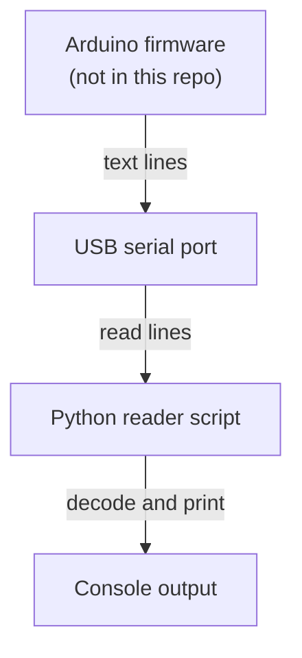

# Project Holo — Arduino serial reader

A small Python utility that opens a serial port, reads lines sent by an Arduino and prints them to the console. It is a historical prototype helper, not a finished application.

This repository contains **only the host-side Python script**. No Arduino firmware, display or visualisation code is included, so it cannot reproduce the full original project on its own.

## What it does

1. Lists the serial ports it can find (`pyserial`).
2. Opens the one you choose at 9600 baud by default.
3. Prints each received line (decoded as UTF-8, replacing undecodable bytes) until you press `Ctrl+C`.

## How it works



*Read-only: the script prints what the device sends and never writes back. No display or visualisation code is included.*

## Requirements

- Python 3.8 or newer
- [`pyserial`](https://pypi.org/project/pyserial/) (see `requirements.txt`)
- An Arduino (or any device) that writes newline-terminated text to its serial port

## Setup

```bash
python -m venv .venv
# Windows: .venv\Scripts\activate      macOS/Linux: source .venv/bin/activate
pip install -r requirements.txt
```

## Usage

The file name contains spaces, so quote it:

```bash
# Prompts for a COM number (Windows-style, e.g. type 3 for COM3)
python "Serial Arduino - Python.py"

# Or name the port directly (also works with /dev/ttyACM0, etc.)
python "Serial Arduino - Python.py" --port COM3
python "Serial Arduino - Python.py" --port /dev/ttyACM0 --baud 115200
```

Options:

| Option | Meaning | Default |
|---|---|---|
| `--port` | Serial port name | prompt for a COM number |
| `--baud` | Baud rate (must match the Arduino's `Serial.begin`) | `9600` |

Close the Arduino IDE serial monitor first, because only one program can hold the port.

## Repository layout

```
Serial Arduino - Python.py   the serial reader (entry point)
requirements.txt             Python dependency (pyserial)
test_serial_reader.py        mocked unit tests (no hardware)
README.md
```

## Known limitations

- Read-and-print only: no parsing, logging to file, plotting or sending data back.
- Reads use a blocking `readline()` with a 1 second timeout (no busy polling). A partial line is printed only if the timeout expires with data pending.
- The interactive prompt assumes Windows-style `COMn` names; use `--port` elsewhere.
- Earlier revisions of the script never opened the port (the connection code was commented out). The port-opening code has now been enabled and the script wrapped in a `main()` guard so importing it has no side effects. The port is closed on `Ctrl+C`. This version has not been run against hardware.

## Tests

`test_serial_reader.py` contains standard-library `unittest` tests that replace `pyserial` with mocks. They check that importing the script and `--help` do not open or enumerate ports, and that `main()` prints a received line and closes the port on `Ctrl+C`. They are isolated unit tests, not hardware validation.

```bash
python -m unittest -v test_serial_reader
```

## Publication and attribution notes

No project-wide license has been selected; preserve existing third-party notices and confirm publication rights before choosing a license. This is historical project work and may involve collaborators; no claim of exclusive ownership is made. `pyserial` is a third-party library with its own license and is not bundled.
