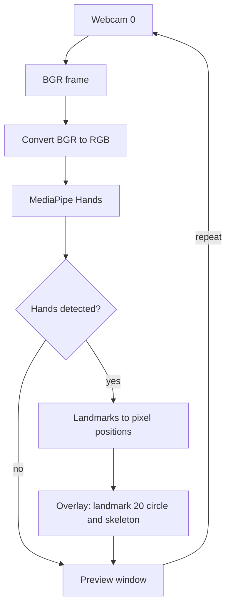

# Project Holo — Hand Tracking

A small webcam hand-tracking prototype. It is the tracking stage of the broader **Hand Tracking System for Computer Control** described in the author's CV and annexes. The supplied source shows the tracking and preview part only.

- Original implementation: [`main.py`](main.py) (preserved unchanged)
- Camera-free check: [`test_tracking.py`](test_tracking.py)
- Documentation: [`docs/PROJECT_DOCUMENTATION.md`](docs/PROJECT_DOCUMENTATION.md)

## What the source does

`main.py` runs as a script and does the following:

1. Opens the default webcam (`cv2.VideoCapture(0)`) when the file is run or imported.
2. Reads a frame (BGR) and converts it to RGB with OpenCV.
3. Runs MediaPipe Hands (`mp.solutions.hands.Hands()`, default settings) on the RGB frame.
4. For each detected hand, loops over its landmarks and converts the normalized coordinates to pixel positions.
5. Draws a filled magenta circle on landmark 20 (the pinky fingertip).
6. Draws the MediaPipe hand skeleton on the frame.
7. Shows the frame in a window named `Output` and repeats.

## Architecture



## Repository layout

| Path | Purpose |
|---|---|
| `main.py` | The original hand-tracking script, unchanged |
| `test_tracking.py` | Dependency-free, substituted-module frame check |
| `requirements.txt` | Proposed dependency set (see Setup) |
| `.gitignore` | Excludes virtual environments, IDE files, caches and environment files |
| `docs/PROJECT_DOCUMENTATION.md` | Scope, evidence and limitations |
| `docs/media/hand-landmark-tracking.png` | Cropped historical overlay image from the project annex |

## Setup

Target: **Windows x64, Python 3.11**.

```powershell
py -3.11 -m venv .venv
.venv\Scripts\python -m pip install -r requirements.txt
.venv\Scripts\python main.py
```

Notes:

- `requirements.txt` is a **proposed compatibility set**, not the author's original lock file or a reproduced environment. It pins `mediapipe==0.10.21`, `opencv-contrib-python==4.11.0.86` and `numpy==1.26.4`.
- This set has **not yet been installed or tested with a camera here**.
- The source uses the legacy `mp.solutions` API. Newer MediaPipe releases are not automatically interchangeable with it.
- Native Windows ARM64 and Python 3.13 are not targets of this compatibility set.
- The virtual environment that came with the original working folder was inconsistent and is not portable, so it is not included.
- The pinned packages are not described as current or secure. Check their advisories before use.

References:

- MediaPipe 0.10.21 package page: <https://pypi.org/project/mediapipe/0.10.21/>
- Upstream legacy Hands module: <https://github.com/google-ai-edge/mediapipe/blob/v0.10.21/mediapipe/python/solutions/hands.py>

The PyPI JSON for 0.10.21 lists `win_amd64` wheels for CPython 3.9–3.12. The earlier 0.9.0 release is no longer available from that endpoint.

## Limitations of the source

- No gesture classification, mouse or keyboard control, serial/Arduino link, or hologram output. Mouse/keyboard control is part of the broader project title, not implemented in this file; no serial or hologram subsystem is claimed.
- The webcam opens at import time.
- There is no check that a frame was read. If the camera fails, `cv2.cvtColor` receives `None` and raises an error.
- There is no exit key, and the camera and window are never released.
- `draw_landmarks` is called inside the per-landmark loop, so the skeleton is drawn once for each of the 21 landmarks per hand per frame.
- Only landmark 20 is highlighted. `Hands()` uses default settings.

## Validation

Run the dependency-free check with `python -I -B test_tracking.py`. It passed three substituted-module frame scenarios (zero, one and two hands); both Python files also passed AST parsing. These checks never open a camera or import the actual OpenCV/MediaPipe packages and do not validate detection accuracy. A pip dry-run resolved the proposed pins for Windows x64 / CPython 3.11; packages were not installed or exercised. The historical image is not a fresh run of this source.

## Privacy

The original working folder contained a private virtual environment and IDE settings. These are not published and are excluded by `.gitignore`. The documentation image is cropped and omits the face.

## Attribution and license

- No new license has been chosen for this repository, and none is granted by this documentation.
- This README makes no claim of sole authorship or of originality of the MediaPipe hand-tracking technique.
- Dependencies are third-party software under their own licenses: MediaPipe, OpenCV and NumPy.
- This tree replaces an earlier, incorrect file set with the corrected source. Earlier Git history is preserved.
