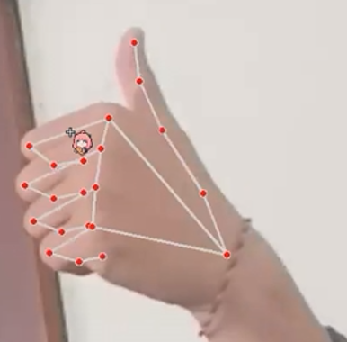

# Project Holo — Hand Tracking: Documentation

Back to [README](../README.md) · Source: [`main.py`](../main.py)

## Scope

This repository holds a **tracking prototype** from the broader **Hand Tracking System for Computer Control**. The source in [`main.py`](../main.py) captures webcam frames, finds hand landmarks with MediaPipe and shows an annotated preview.

The author identifies this code as the replacement Project Holo. It is the tracking stage only. This repository contains no code for gesture classification, mouse or keyboard control, serial/Arduino communication or hologram output.

## Source evidence

The only supplied implementation file is `main.py` (819 bytes), preserved unchanged. `test_tracking.py` was added during publication preparation. Its behavior:

| Step | Code behavior |
|---|---|
| Capture | `cv2.VideoCapture(0)` at import |
| Color | `cv2.cvtColor(image, cv2.COLOR_BGR2RGB)` |
| Detection | `mp.solutions.hands.Hands()` with default settings; `hands.process(imageRGB)` |
| Landmarks | Loops over `multi_hand_landmarks` and each hand's landmarks; converts `lm.x`, `lm.y` to pixels |
| Marker | Filled magenta circle (radius 25, BGR `(255, 0, 255)`) at landmark id 20, the pinky tip |
| Skeleton | `draw_landmarks(..., HAND_CONNECTIONS)`, called inside the landmark loop |
| Display | `cv2.imshow("Output", image)` and `cv2.waitKey(1)` in an endless loop |

## Historical evidence

*Cropped historical hand-landmark overlay from the project annex; face omitted. Not proof of mouse/keyboard actions or a fresh run of this source.*

Source: the "Hand Tracking System for Computer Control" heading in the author's Annexes document, image immediately following that heading. The still is cropped to the hand; the full document, uncropped portrait and video are not published here. The historical overlay is contextual evidence, not a pixel-for-pixel match to this script.

## Limitations

- No frame-read guard: a failed camera read gives `None` to `cv2.cvtColor`, which raises an error.
- No exit key, and no release of the camera or window.
- The camera opens at import, so importing the file starts capture.
- The skeleton is drawn repeatedly inside the per-landmark loop.
- No control actions, as described in Scope.
- Not tested with a camera in this documentation pass.

## Setup and dependencies

See [README — Setup](../README.md#setup). `requirements.txt` is a proposed compatibility set (`mediapipe==0.10.21`, `opencv-contrib-python==4.11.0.86`, `numpy==1.26.4`) for Windows x64 and Python 3.11. It is not the original lock file and has not been installed or hardware-tested here. The source needs the legacy `mp.solutions` API, so newer MediaPipe releases are not automatically interchangeable.

References:

- <https://pypi.org/project/mediapipe/0.10.21/>
- <https://github.com/google-ai-edge/mediapipe/blob/v0.10.21/mediapipe/python/solutions/hands.py>

## Validation

Run `python -I -B test_tracking.py` from the repository root. Three frame scenarios (zero, one and two hands) passed with both OpenCV and MediaPipe replaced by stand-ins. Both Python files also passed AST parsing. A pip dry-run resolved the proposed dependencies for Windows x64 / CPython 3.11 without installing them. These checks are not a MediaPipe inference run, a camera run or evidence of tracking accuracy.

## Privacy

A private virtual environment and IDE settings from the original working folder are excluded. The annex image is cropped to omit the face.

## Attribution and license

No new license has been chosen. This documentation makes no sole-authorship claim. MediaPipe, OpenCV and NumPy belong to their respective owners and licenses. The current tree replaces an earlier incorrect file set; earlier history stays in Git.
